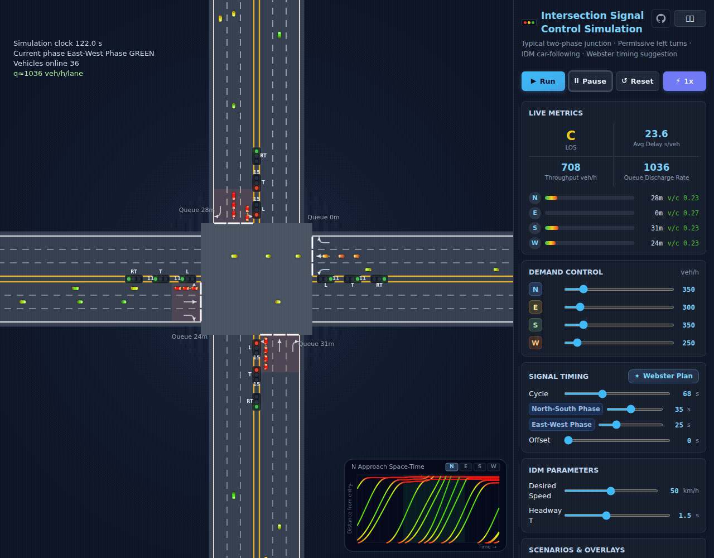

<div align="center">

# Intersection Signal Lab

**十字路口信号控制仿真 · 左转让行观察 · 配时与排队可视化**


[](./LICENSE)

**[在线体验](https://seanwong17.github.io/intersection-signal-lab/) · [English](./README.en.md) · [反馈问题](https://github.com/SeanWong17/intersection-signal-lab/issues)**

调整车流与绿灯时间，观察车辆如何排队、放行，以及左转为何在绿灯时仍需等待。

</div>



演示使用英文界面，应用支持中英文切换。[观看 MP4 演示](./media/demo.mp4)。

纯前端、无需安装依赖，直接打开 `index.html` 即可运行。适合交通工程学习、课堂演示与仿真代码实验。

## 核心能力

| 模块 | 可观察和调整的内容 |
|---|---|
| 信号控制 | 南北 / 东西两相位，周期、绿灯时间与相位差，各进口独立倒计时 |
| 车辆运行 | 泊松到达、IDM 跟驰、左转让行、路口冲突预约 |
| 拥堵观察 | 四进口独立需求、上游排队覆盖、过饱和场景 |
| 配时分析 | Webster 建议配时、v/c、LOS、平均延误与启动流率 |
| 可视化 | 实时车辆、中央分隔带信号灯、四进口时空图、中英文界面 |

## 功能

- 两相位对向同放，左转让行，右转常绿
- 四个进口流量独立可调，并按左直右比例分配到车道
- 支持周期、南北相位绿灯、东西相位绿灯和相位差调整
- 支持 `Webster 配时` 一键生成建议周期和绿灯分配
- 内置 `过饱和` 和 `绿波协调` 场景
- 实时显示 LOS、平均延误、通行量和排队启动流率
- 进口时空图支持北、东、南、西方向切换
- 中英文界面切换时，侧栏、告警和画布标注同步更新

## 模型说明

- 路口范围：单个孤立四叉交叉口
- 车道设置：每个进口 1 条左转、1 条直行、1 条右转
- 到达过程：按进口流量和车道份额拆分的泊松到达
- 跟驰逻辑：IDM
- 信号逻辑：两相位对向同放，左转让行，右转常绿
- 启动流率：根据排队放行头时距估计，单位为 `辆/h/车道`
- 绿波场景：单点相位差示意，不包含走廊级协调控制

### 左转绿灯为什么还会停车？

本项目没有独立的保护左转相位。南北或东西对向同时放行时，左转与对向直行同绿，左转车辆仍需等待对向直行空档和路口冲突预约释放。红灯表示信号禁止通行，绿灯表示信号允许通行，但不保证车辆能立即进入路口。

中央分隔带的 `L`、`T`、`RT` 分别对应左转、直行、右转，按距停车线由近到远排列。红灯数字表示距下一次变绿的时间，绿灯与黄灯数字表示当前灯色剩余时间。

### 适用范围

这是教学用简化模型，不是经过实测标定的道路设计工具。Webster 采用同时放行进口的最大关键流量比，未单独标定许可左转容量；路口冲突预约使用保守的运动冲突表。平均延误基于已离场车辆，未包含仍在排队车辆及场外积压的等待时间。绿波按钮仅演示单点相位差，不代表真实多路口协调。

## 快速开始

直接在浏览器打开 `index.html` 即可，无需安装依赖。

也可以直接访问在线演示：<https://seanwong17.github.io/intersection-signal-lab/>

如需复现同一组运行结果，可在 URL 后加固定随机种子：

```text
index.html?seed=20260324
```

## 使用说明

### 画布区域

画布区域展示车辆运行、停车线、信号灯头、排队覆盖、状态提示条以及进口时空图。

### 控制面板

- `运行` / `暂停` / `重置`：控制仿真状态
- 流量控制：调整四个进口需求
- 信号配时：调整周期、两相位绿灯和相位差
- `Webster 配时`：按当前需求自动生成建议配时
- `过饱和`：切换到高需求拥堵场景
- `绿波协调`：切换到单点相位差演示场景
- 可视化开关：显示或隐藏排队波、启动流率标注和进口时空图

### 实时指标

- LOS 服务水平：根据平均延误映射得到等级
- 平均延误：单位为 `s/辆`
- 通行量：折算为 `辆/h`
- 排队启动流率：根据排队放行头时距估计

## 浏览器支持

- 推荐浏览器：Chrome / Edge 最新版
- 支持 Safari / Firefox 最新版
- 如需录制稳定的演示素材，建议使用固定随机种子

## 质量检查

项目包含不依赖第三方包的模型与发布回归检查：

```bash
node tests/release-check.js
```

检查覆盖固定随机种子、Webster 配时、v/c、排队检测、左转让行、车头到线时的冲突拦截、分进口倒计时及相位差、车辆路径、时空图采样与过饱和场景参数一致性。

## 目录结构

- `media/demo.gif`：README 使用的演示动图，展示场景切换和交互流程。
- `media/demo.mp4`：同一演示的 MP4 版本。
- `index.html`：页面入口，定义画布、控制面板和各类 UI 节点。
- `LICENSE`：项目开源协议。
- `README.md`：中文使用说明。
- `README.en.md`：英文使用说明。
- `src/intersection.analytics.js`：LOS、延误、启动流率、Webster 相关计算逻辑。
- `src/intersection.config.js`：仿真默认参数和几何常量配置。
- `src/intersection.css`：页面布局、控件样式和响应式样式。
- `src/intersection.geometry.js`：路口几何、车道边界、停车线和信号灯头位置计算。
- `src/intersection.i18n.js`：中英文文案和界面语言切换逻辑。
- `src/intersection.models.js`：车辆、信号机、排队检测等核心数据模型。
- `src/intersection.render.js`：画布绘制逻辑，包括车辆、排队覆盖、标注和时空图。
- `src/intersection.simulation.js`：车辆生成、跟驰、放行和仿真时间推进逻辑。
- `src/intersection.ui.js`：控件绑定、场景切换、指标刷新和 UI 状态同步。
- `tests/release-check.js`：核心模型、仿真约束与发布参数回归检查。

## 致谢

本项目在开发和发布整理过程中使用了 AI 工具协作，包括 Claude 和 GPT。

## 开源协议

本项目采用 [MIT License](./LICENSE)。
